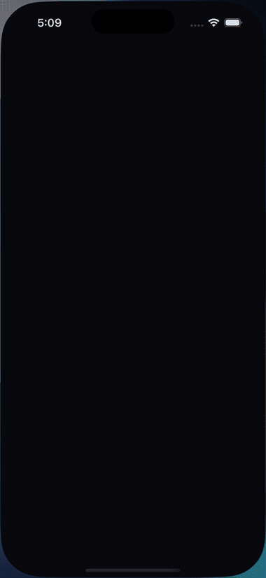
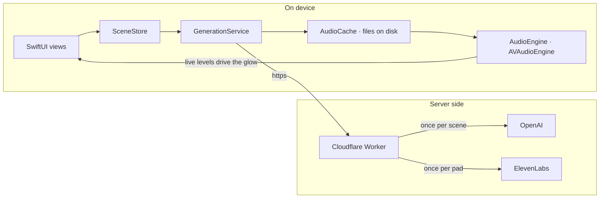

# Foley

Describe a scene. Foley turns it into four to six AI-generated sound effects you can tap, layer, loop and mix
on a board of glowing pads, then record the result and share it as audio or a 9:16 video.

A native SwiftUI app for iOS 26, built as a portfolio piece: the motion and the audio-reactive UI matter as
much as the features.



## Run it

```bash
git clone <this repo> && cd Foley
cp Config/Local.xcconfig.example Config/Local.xcconfig
open Foley.xcodeproj          # press Run
```

No keys, no setup: the app ships with two demo scenes ("Pirate ship in a storm" and "Rainy café in Tokyo")
that play immediately. Describing a *new* scene needs the proxy below.

From the command line:

```bash
scripts/build.sh      # build for the simulator
scripts/test.sh       # 41 unit tests
scripts/run.sh        # build, install and launch
```

## Generate your own scenes

The app never holds an API key. Every network call goes through a small Cloudflare Worker that keeps the
keys as secrets and rate-limits per device.

```bash
cd proxy
npx wrangler login
npx wrangler kv namespace create COUNTERS   # paste the id into wrangler.toml
npx wrangler secret put OPENAI_API_KEY      # scene parsing
npx wrangler secret put ELEVENLABS_API_KEY  # sound generation
npx wrangler deploy
```

Put the printed URL in `Config/Local.xcconfig` (gitignored, never committed):

```
FOLEY_PROXY_URL = https://foley-proxy.<your-account>.workers.dev
```

Details, limits and curl examples: [`proxy/README.md`](proxy/README.md).

## How it works



1. **Build scene** sends the prompt to the Worker, which asks OpenAI for four to six sound prompts plus a
   mood palette, each tagged with the exact words it came from.
2. Those words **fly out of the prompt into their pads** while each sound generates, three at a time.
3. Every file is **cached on disk** under a hash of its spec, so the same sound is never paid for twice.
4. `AudioEngine` mixes one player node per pad and publishes levels at 60 Hz. **Everything that glows,
   pulses or spins is following real audio**, not a timer.

## Design notes

- Dark only, six fixed sound tints, every value from `Foley/Design/Theme.swift` — no hex in any view.
- One hero moment (the word-to-pad flight) and one living system (level-driven glow); everything else is calm.
- Liquid Glass on the floating chrome: transport dock, header buttons, pills, segmented controls.
- Reduce Motion replaces morphing, spinning and flight with fades. Every pad is a labelled button with an
  Edit action; orbit nodes expose volume and pan as adjustable values.
- The 9:16 share video is drawn frame by frame with Core Graphics from the recorded mix's per-pad level
  envelope, then muxed with the audio by `AVAssetWriter`.

## Layout

| Path | What's in it |
| --- | --- |
| `Foley/Design` | Tokens, motion vocabulary, glass helper |
| `Foley/Models` | SwiftData models, sound spec and cache key, proxy contracts |
| `Foley/Services` | Audio engine, cache, generation services, scene store, mix renderer, dictation |
| `Foley/Components` | Orb, pad, meters, chips, composer, dock, waveform, orbit node |
| `Foley/Screens` | The nine screens |
| `proxy/` | The Cloudflare Worker |
| `docs/handoff/` | The original design handoff: screens, tokens, spec |

Sounds generated with ElevenLabs.
