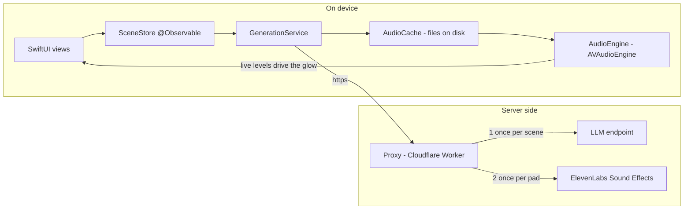

# Foley — Build Handoff

Nov 13, 2026 · Akintade Oluwaseun

> Bundle contents: `design/` (screens as HTML + PNG, open `design/index.html`), `tokens/tokens.json`, `swift/` (SwiftUI starter components), `proxy/worker.js`. Live versions: [design canvas](https://claude.ai/artifact/575gkBo5vtZa2Agcob3EoC) · [this doc](https://claude.ai/artifact/CKj2r2k6ksrr2CvyTn9kfJ).

## Overview

Foley is a native SwiftUI iOS app: you describe a scene, it turns that into 4–6 AI-generated sound effects, and you tap, layer, loop and mix them on a board of glowing pads. It is a portfolio piece, so motion and audio-reactive UI matter as much as the features.

- **Platform:** iOS 18+, SwiftUI, Swift 6, iPhone only (portrait).
- **Sound generation:** ElevenLabs Sound Effects API, called through a small proxy.
- **Scene parsing:** an LLM splits the user's prompt into named sound prompts with a mood palette.
- **Design source:** `design/` in this bundle (9 screens). Treat it as the visual reference; this doc is the spec.

**In scope:** create a scene, generate pads, play/loop/layer, orbit mixer, edit and regenerate a pad, record a mix, share, saved scenes library, 2 bundled demo scenes that run with no API key.

**Out of scope for v1:** accounts, cloud sync, iPad layout, remixing other people's scenes (the Share scene button can stub to a share sheet with a text summary).

## Architecture

The app never holds an API key: every network call goes through a small proxy, and every generated sound is saved to disk so it is paid for once.



1. **Build scene:** GenerationService sends the prompt to the proxy, which asks an LLM for 4–6 sound prompts plus a mood palette.
2. **Per pad:** for each sound, the proxy calls ElevenLabs and streams the audio back. Run pad jobs concurrently (max 3 at once) and update each pad's state as it lands.
3. **Cache:** AudioCache writes each file to Application Support, keyed by a hash of text + duration + loop + prompt influence. A cache hit skips the network entirely.
4. **Play:** AudioEngine loads buffers into one AVAudioPlayerNode per pad, mixes them, and publishes live levels that drive the pad glow.

**Proxy:** a Cloudflare Worker with two routes, `POST /scene` and `POST /sound` (starter in `proxy/worker.js`). It stores the ElevenLabs and LLM keys as secrets and rate-limits per device ID. Any serverless option works; keep it under 100 lines.

**Demo mode:** bundle 2 scenes (audio files + scene JSON) in the app so the repo runs with no keys. Recruiters cloning it should hear sound on first launch.

## Design tokens

Dark only for v1. Every value below is in `swift/Theme.swift` and `tokens/tokens.json`, so no hex appears in a view.

**Base colours**

| Token | Hex | Use |
| --- | --- | --- |
| bg | #0A0A0C | App background (create, export, library) |
| sceneBg | #0B0F1A | Board background, under the mood gradient |
| sceneGlow | #15213D | Top of the board's radial/mesh gradient (default mood) |
| surface | #141418 | Inputs, chips, list rows |
| padSurface | #121A2C | Idle pad fill on scene screens |
| padActive | #16213A | Playing pad fill |
| sheet | #121624 | Bottom sheet background |
| border | #26262D | Default 1pt borders (neutral screens) |
| sceneBorder | #243150 | Borders on scene screens |
| textPrimary | #F4F4F5 | Body and headings; also the primary button fill |
| textSecondary | #A1A1AA | Secondary text on neutral screens |
| sceneSecondary | #A9B4CC | Secondary text on scene screens |
| textTertiary | #8B8B94 | Section labels (uppercase) |
| record | #FF5A5F | REC dot, record states |
| error | #FF8FA3 | Failed pad icon, Delete button text |

**Sound tints** — each pad gets one tint. The orb is a radial gradient: highlight at 0%, tint at ~38%, shadow at ~78%, centre offset to (36%, 34%). Glow = tint at 26–30% opacity.

| Tint | Highlight | Base | Shadow |
| --- | --- | --- | --- |
| amber | #FFD9A0 | #FFB547 | #8A4E10 |
| blue | #DCE8FF | #8FB8FF | #2A4AA8 |
| teal | #C8FAF2 | #5EE0CF | #1E7A6E |
| lavender | #ECE5FF | #C2AEFF | #5A3FB8 |
| sky | #D6F2FF | #7FD6FF | #1F6D96 |
| pink | #FFE0EA | #FFA3C0 | #A8385E |

The LLM picks a tint per sound from this fixed list (never free hex), so pads always look on-brand.

**Type** — the design files use Space Grotesk and Inter; in the app use SF Pro (system) to keep it native.

| Role | Size / weight | SwiftUI |
| --- | --- | --- |
| Hero title | 34pt, semibold, tracking −0.03em | `.system(size: 34, weight: .semibold)` |
| Screen title | 30pt, semibold | `.system(size: 30, weight: .semibold)` |
| Sheet / card title | 22–28pt, semibold | |
| Pad name | 15pt, semibold | `.subheadline.weight(.semibold)` |
| Body | 15–16pt, regular | `.body` |
| Meta | 12–13pt, regular | `.caption` / `.footnote` |
| Section label | 12pt, semibold, uppercase, tracking 0.08em | |

Numbers that change (timers, percentages) use `.monospacedDigit()`.

**Spacing and shape**

- Screen padding: 20pt sides. Content starts below the safe area.
- Spacing scale: 4, 8, 12, 16, 20, 24. Pad grid gap is 12.
- Radii: pads 28, cards 28–32, sheet top 34, inputs 26, list rows 20, chips and pills fully round (`Capsule`).
- Touch targets: 44pt minimum. Icon buttons are 44×44 circles; the main transport button is 64×64.
- Icons: SF Symbols, 1.8pt-ish stroke look (`.fontWeight(.medium)`).

## Components

Build these as standalone views with SwiftUI previews for every state before wiring screens. Most screens are just these composed. Starters for the ones marked ✓ are in `swift/`.

| Component | Props | States | Notes |
| --- | --- | --- | --- |
| `SoundOrb` ✓ | tint, size, level (0–1), mode | idle, generating, ready, playing | The visual heart. Radial gradient + glow. Generating = blurred, morphing blob. Playing = scale 1 + level × 0.12, glow radius from level. |
| `PadView` ✓ | pad, level, onTap, onLongPress | queued, generating, ready, playing, failed | Rounded 28 card, 150–168pt tall. Orb top-right, partly clipped. Kind icon top-left (loop / bolt). Name + meta bottom-left. |
| `LoopRing` ✓ | tint, progress | spinning | Dashed 1.5pt circle around the orb on looping pads. Rotation tied to loop progress, not a fixed timer. |
| `MiniMeter` ✓ | level | live | 3 white bars, 4pt wide, bottom-aligned. Shown on playing pads. |
| `MasterMeter` ✓ | levels[40], tints | silent, live | 44pt tall row of bars across the screen, coloured by active pad tints. Silent = 4pt flat bars. |
| `KeywordText` | text, matches[] | typing, parsed | Prompt text with highlighted ranges: tint at 16% fill + 2pt underline in the tint. |
| `SoundChip` ✓ | name, tint, isNew | default, just-added | Capsule, 34pt tall, tint dot + name. Just-added pops in (scale 0.6 → 1.08 → 1) with a tinted border. |
| `SuggestionChip` ✓ | title, tint | default, pressed | Capsule 40pt, tint dot. Tap fills the composer. |
| `Composer` ✓ | text, onDictate, onSubmit | empty, has text, disabled | 26-radius field with mic and send buttons. Send disabled (grey) when empty. |
| `TransportDock` ✓ | mode, isPlaying, isRecording | idle, playing, recording | Floating 40-radius bar: Grid/Orbit toggle, 64pt play/stop, Rec/Done pill. |
| `RecPill` ✓ | elapsed | recording | Red-tinted capsule with pulsing dot and `REC 0:12`. |
| `OrbitNode` | pad, distance, pan | resting, dragging | Circle orb with name under it. Size scales with volume. Dragging = scale 1.06, ring halo, readout pill (e.g. `82% · R30`). |
| `WaveformView` ✓ | samples[], progress, tint | static, playing, drawing | Bars from downsampled peaks. Played part in tint, rest at #2E3A58. Drawing = bars appear left to right. |
| `PadSheet` | pad | editing, regenerating | Bottom sheet: orb header, waveform, prompt field, loop toggle, length + prompt-influence sliders, Delete / Regenerate. |
| `SceneCard` | scene | default | Library row: mood-tinted gradient, row of small orbs, title, meta, play button. |
| `ShareRow` | icon, title, subtitle | default, busy | 64pt row with icon tile. Busy shows a progress ring while exporting. |

**Pad state machine** (lives on the `Pad` model, drives `PadView`):

1. `queued` → dashed border, tiny blob, "Queued".
2. `generating` → breathing blob, shimmering "Generating…".
3. `ready` → solid orb pops in, kind icon, meta (e.g. "Loop · 10s").
4. `playing` → tint border + glow, orb pulses with level, loop ring or flash, mini meter.
5. `failed` → red-tinted card, alert icon, "Couldn't make this one", Retry button. Retry returns to `generating`.

## Screens and states

Nine screens, numbered as in `design/png/`. Navigation: `NavigationStack` from Library/Home → Create → Board; Pad sheet and Export are sheets over the Board.

| # | Screen | Layout | States to build |
| --- | --- | --- | --- |
| 01 | Home / Create (empty) | Wordmark + library button; centred idle `SoundOrb` with dashed orbit ring; "Describe a scene."; suggestion chips; `Composer` pinned bottom | Empty, chip tapped (types itself in), composer focused |
| 02 | Typing | Close button, "Listening for sounds" status; large `KeywordText` card; "N sounds detected" `SoundChip` row (max 8); settings card (ambient loops toggle, clip length); full-width "Build scene" button | Parsing, 0 sounds (button disabled + hint), N sounds, over max (extra chips greyed) |
| 03 | Generating | Back, scene title, "Building 3 of 6…", progress bar; 2-col pad grid in mixed states; source prompt at bottom with keyword gaps where words flew out | Each pad state in the state machine; all failed (full-screen retry); network offline banner |
| 04 | Board (idle) | Back + more; title + "6 sounds · tap to play, hold to edit"; 2×3 pad grid; `TransportDock` | Idle, 1–8 pads (grid reflows), demo scene badge |
| 05 | Playing | Same as Board plus `RecPill` in the header and `MasterMeter` under the title; playing pads glow | Nothing playing, some playing, all playing, recording |
| 06 | Orbit mixer | Header with reset; 350pt orbit area (3 rings, YOU node in centre, pads as `OrbitNode`s, L/R markers); legend; master volume slider; Grid/Orbit segmented control | Resting, dragging a pad (dashed line to centre + readout), reset animating |
| 07 | Pad sheet | Sheet from y≈150: orb + name + meta + close; play + `WaveformView`; prompt field; Loop/One-shot; Length (0.5–22s); "Follow my prompt" (0–1); Delete + Regenerate | Editing, regenerating (orb melts to blob, controls disabled), regenerate failed |
| 08 | Mix recorded | "Mix saved" header; hero card with orb row, title, "6 layers · 0:42", waveform, play; Share rows (video 9:16, audio .m4a, share scene); "Sounds generated with ElevenLabs" | Rendering (waveform draws), ready, exporting video (row busy), export failed |
| 09 | Library | "Your scenes" + new button; search; `SceneCard` list | Empty (first launch shows the 2 demo scenes), list, search no results |

**Copy rules:** sentence case everywhere; pad meta is `Loop · 10s` or `One-shot · 4s`; errors say what happened and offer one action ("Couldn't make this one" + Retry).

**Accessibility:** every pad is a `Button` with label "<name>, <loop or one-shot>, playing/not playing"; long-press also available as an accessibility action "Edit"; Orbit nodes expose volume/pan as adjustable actions; respect Reduce Motion by swapping breathing/spin animations for opacity fades.

## Motion and haptics

One hero moment, one living system, everything else calm. The hero is the word-to-pad flight on Build; the living system is pads reacting to real audio levels.

| Moment | What moves | SwiftUI approach | Haptic |
| --- | --- | --- | --- |
| Idle orb (01) | Orb scales 0.94 ↔ 1.05 over 5s; dashed ring rotates over 40s | `phaseAnimator` or `.repeatForever` | — |
| Chip → composer (01) | Chip text types in at ~30 chars/s | Task loop appending characters | Light tick per word |
| Keyword detected (02) | Highlight fades in; new `SoundChip` pops | `.transition(.scale.combined(with: .opacity))`, spring | `.sensoryFeedback(.selection)` |
| **Build → pads (hero, 02→03)** | Each keyword lifts out of the prompt and flies to its slot, staggered 80ms; the prompt keeps a dotted gap where it was | `matchedGeometryEffect` keyed by sound ID across the two layouts, `.spring(response: 0.55, dampingFraction: 0.72)` | Soft impact per landing |
| Generating pad (03) | Blurred blob morphs shape and breathes, 2.8–3.6s, offset per pad | `TimelineView(.animation)` + `Canvas` or a Metal `.layerEffect` noise shader | — |
| Pad ready (03) | Blob snaps into a solid orb: scale 0.6 → 1.08 → 1 | `keyframeAnimator` | `.sensoryFeedback(.success)` |
| Pad failed (03) | Card shakes once (3 oscillations, 6pt) | `keyframeAnimator` on x offset | `.error` |
| Pad playing (05) | Orb scale and glow follow live level; loop ring rotates with loop position; one-shots flash on trigger | Read levels from `AudioEngine` at 60fps (`TimelineView`), not a fixed animation | Core Haptics pattern per tint (thunder = heavy rumble, cat = sharp tick) on trigger |
| Transient ripple (05) | Big peaks push a ripple into neighbouring pads | Ripple `.distortionEffect` shader triggered on peak > threshold | — |
| Grid ↔ Orbit (05↔06) | Pads travel from grid cells to orbit positions | `matchedGeometryEffect` keyed by pad ID | Light impact |
| Orbit drag (06) | Node scales to 1.06 with halo; dashed line to centre; readout pill follows | `DragGesture`; volume = 1 − distance/maxRadius, pan = x offset / radius | Selection tick at 25/50/75/100% |
| Pad sheet (07) | Sheet zooms out of the pressed pad | `.navigationTransition(.zoom(sourceID:in:))` | Medium impact on long-press |
| Regenerate (07) | Orb melts back into a breathing blob in place | Cross-fade `SoundOrb` mode with a spring | — |
| Mix waveform (08) | Bars draw left to right as the file renders | Animate a `progress` mask | Success on finish |
| Library scroll (09) | Cards scale 0.94 and fade toward the edges | `.scrollTransition` | — |

**Rules:** springs everywhere, no linear timing except continuous loops. Keep every haptic subtle and never fire more than ~10 per second. With Reduce Motion on, replace morphing, spinning and flight with opacity fades.

## Data models and API contracts

Persist scenes with SwiftData; audio files live in Application Support, referenced by cache key. Full starter in `swift/Models.swift`.

```swift
enum Tint: String, Codable, CaseIterable { case amber, blue, teal, lavender, sky, pink }
enum PadKind: String, Codable { case loop, oneShot }
enum PadStatus: Equatable { case queued, generating, ready, playing, failed(String) }

struct SoundSpec: Codable, Hashable {
    var prompt: String          // "Close thunder crack rolling into the distance"
    var duration: Double?       // 0.5–22s, nil = auto
    var loop: Bool
    var promptInfluence: Double // 0–1, default 0.3
}

@Model final class Scene {
    var id: UUID
    var title: String           // "Pirate ship in a storm"
    var sourcePrompt: String
    var mood: Tint
    var createdAt: Date
    var isDemo: Bool
    @Relationship(deleteRule: .cascade) var pads: [Pad]
}

@Model final class Pad {
    var id: UUID
    var name: String            // "Thunder crack"
    var keyword: String         // matched text in the source prompt
    var tint: Tint
    var kind: PadKind
    var spec: SoundSpec
    var cacheKey: String?       // sha256(spec), nil until generated
    var volume: Double = 0.8    // from the orbit mixer
    var pan: Double = 0         // -1...1
    var version: Int = 1
}
```

`PadStatus` is transient UI state held in `SceneStore`, not persisted.

**Proxy: `POST /scene`**

```json
// request
{ "prompt": "Creaky pirate ship in a thunderstorm, heavy rain..." }
// response
{
  "title": "Pirate ship in a storm",
  "mood": "blue",
  "sounds": [
    { "name": "Creaking hull", "keyword": "creaky pirate ship", "tint": "amber",
      "kind": "loop", "prompt": "Old wooden ship hull creaking at sea", "duration": 10 }
  ]
}
```

The LLM must return 1–8 sounds, ambient beds as loops, short events as one-shots, tints from the fixed list, and `keyword` as an exact substring of the prompt (used for highlighting and the flight animation). Validate with `Codable` and fall back to a retry with a stricter prompt.

**Proxy: `POST /sound`** forwards to ElevenLabs and streams audio back.

```json
// request (app → proxy)
{ "text": "Old wooden ship hull creaking at sea", "duration_seconds": 10,
  "loop": true, "prompt_influence": 0.3 }
// proxy → ElevenLabs
POST https://api.elevenlabs.io/v1/sound-generation?output_format=mp3_44100_128
header xi-api-key: <secret>
body: same fields + "model_id": "eleven_text_to_sound_v2"
// response: audio/mpeg bytes
```

Duration is 0.5–22 seconds; `loop` only works on the `eleven_text_to_sound_v2` model. Each generation costs about 200 credits, so the cache is mandatory. Map errors to user copy: 401/5xx → "Couldn't make this one", 429 → "Too many at once, retrying" (auto-retry with backoff), 422 → log and mark failed.

**AudioEngine API** (the only thing views talk to; starter in `swift/AudioEngine.swift`):

```swift
@Observable final class AudioEngine {
    func load(padID: UUID, kind: PadKind, url: URL) throws
    func toggle(_ padID: UUID)          // loop: start/stop, one-shot: trigger
    func stopAll()
    func setVolume(_ v: Double, pan: Double, for padID: UUID)
    private(set) var levels: [UUID: Float]   // 0–1, updated ~60Hz from a tap
    private(set) var masterLevels: [Float]   // 40 bins for MasterMeter
    func startRecording() throws
    func stopRecording() -> URL?             // .m4a
}
```

## Build order and acceptance criteria

Build sound first, then the hero animation, then polish. Each step should be demoable on a real iPhone before moving on.

1. **Audio core:** `AudioEngine` with 2 bundled demo files: toggle, loop, one-shot, volume/pan, live levels.
2. **Components in previews:** `SoundOrb`, `PadView` (all 5 states), `TransportDock`, driven by fake levels.
3. **Board + Playing (04–05):** demo scene fully playable; glow follows real levels; recording to .m4a works.
4. **Proxy + generation:** `/scene` and `/sound` live; `GenerationService` with concurrency 3, cache, retries.
5. **Create flow (01–03):** composer, keyword highlighting, Build with the word-to-pad flight.
6. **Pad sheet (07)** with regenerate, then **Orbit mixer (06)**.
7. **Export + Library (08–09)**, including the 9:16 share video.
8. **Polish pass:** haptics, Reduce Motion, VoiceOver labels, error copy, app icon.

**Done when:**

- [ ] Fresh clone runs with no keys and plays both demo scenes
- [ ] A typed scene produces 4–6 playable pads in under ~20s on Wi-Fi
- [ ] Regenerating the same spec never calls the API twice (cache hit)
- [ ] 6 pads looping together hold 60fps on iPhone 13 with live glow
- [ ] Failed pads show Retry and recover without restarting the scene
- [ ] No API key or secret anywhere in the app bundle or repo
- [ ] Recorded mix exports as .m4a and as a 9:16 video
- [ ] Every screen works with VoiceOver and Reduce Motion
- [ ] README with a 20-second demo GIF, architecture diagram and setup steps for the proxy

**Sources:** [ElevenLabs sound generation endpoint](https://www.withone.ai/knowledge/elevenlabs/conn_mod_def%3A%3AGJ2a6lR4H0w%3A%3AIXG0MpPmTvmtXy1QEZITPA/md) · [ElevenLabs Python SDK sound effects reference](https://www.mintlify.com/elevenlabs/elevenlabs-python/api-reference/audio/sound-effects) · [Credit costs per tool](https://www.stork.ai/blog/is-elevenlabs-free-2026)
